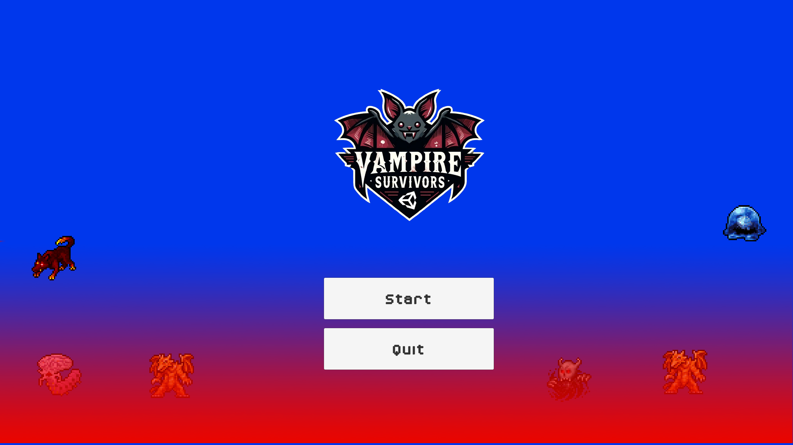

# Alien Survivors



"Alien Survivors" is a 2D survival arcade game built with Unity, where players must endure waves of extraterrestrial and supernatural enemies. In this action-packed game, players choose a character with unique abilities to survive against relentless hordes of alien invaders and monstrous creatures.

## Table of Contents

- [Getting Started](#getting-started)
  - [Prerequisites](#prerequisites)
  - [Installation](#installation)
- [Playing the Game](#playing-the-game)
  - [Controls](#controls)
  - [Gameplay Overview](#gameplay-overview)
- [Development](#development)
  - [Project Structure](#project-structure)
- [License](#license)
- [Contact](#contact)

## Getting Started

These instructions will get you a copy of the project up and running on your local machine for development and testing purposes.

### Prerequisites

What things you need to install the software and how to install them:

```bash
Unity Editor (Unity 6 / 2021.3 LTS or newer)
Git
